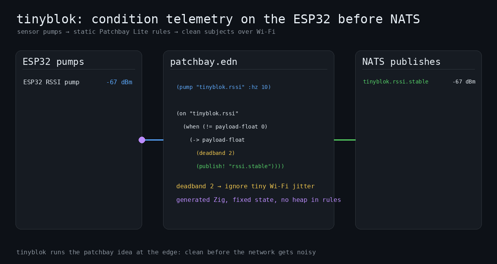
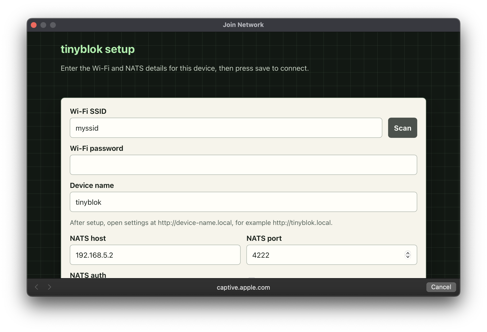
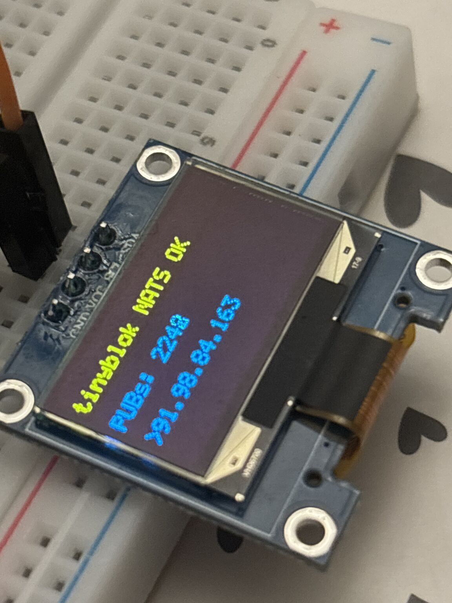

# tinyblok

Runs a message conditioning  _patchbay_ (see below animation) on ESP32 boards, and publishes conditioned sensor streams to NATS. It is the miniature counterpart to [lexvicacom/monoblok](https://github.com/lexvicacom/monoblok) - take a look for more context, or read the [tinyblok intro blog post](https://alexjreid.dev/posts/tinyblok/).

> Flash an ESP32, configure Wi-Fi/NATS in a browser, declare useful telemetry subjects, publish clean values.



**Using a Raspberry Pi?** Run monoblok itself instead of tinyblok. It now ships
binaries for every Pi, including the Pi Zero W, and gives you the full patchbay.
See [tinyblok or monoblok](#tinyblok-or-monoblok).

## Install

The fastest path is browser-based flashing: open <a href="https://flash.monoblok.host" target="_blank" rel="noopener">flash.monoblok.host</a> in Chrome or Edge, plug the board in over USB, and pick a port.

To build and flash from source:

```sh
git submodule update --init --recursive
make build
make flash
make monitor
```

`make flash` auto-detects the serial port; pass `PORT=/dev/cu.usbmodem101`
(or similar) to override. ESP-IDF must be installed; see
[make commands](#make-commands) below for `IDF_PATH` / `IDF_EXPORT` overrides.

Exit `make monitor` with **Ctrl+]** (Ctrl+C is trapped by the monitor).

## First-time setup

After flashing, the device boots into a captive setup portal. No serial
console or pre-baked credentials are needed.

1. Join the `TINYBLOK` Wi-Fi network advertised by the device.
2. The captive portal should open automatically. If it does not, open `http://10.42.0.1`.



3. Enter Wi-Fi, device name, and NATS settings.
4. Save. Tinyblok attempts the Wi-Fi connection, stores the config as valid on success, and reboots.
5. Now configured, the settings page is available at `http://tinyblok.local` by default. If you set the device name to `kitchen`, open `http://kitchen.local`.

The device name is used as the mDNS hostname after setup. Use simple letters,
numbers, spaces, underscores, or hyphens; firmware normalizes it to a
lowercase `.local` hostname with hyphens.


## What it does

- Connects to Wi-Fi, then NATS over TCP or TLS.
- Supports no auth, user/pass, or NATS `.creds` auth - **works with Synadia Cloud** and other operator mode clusters.
- Publishes heap, RSSI, uptime, and temperature-derived subjects from [patchbay.edn](./patchbay.edn).
- Can optionally render device status on attached LCD/OLED displays, including NATS connection status and publish counters.
- Runtime Wi-Fi and NATS settings are stored in NVS and editable later over HTTP.




## Changing settings later

Open `http://<device-name>.local` on the same LAN, for example
`http://tinyblok.local` or `http://kitchen.local`. Use that page to change
Wi-Fi, device name, and NATS settings. The page saves settings to NVS; reboot
from the page if a change needs a clean reconnect.

The same API is available on the LAN:

- `GET /api/status`
- `GET /api/settings`
- `GET /api/wifi-scan`
- `POST /api/settings`
- `POST /api/reboot`
- `POST /api/factory-reset`

For example:

```sh
curl http://tinyblok.local/api/status
curl -X POST http://tinyblok.local/api/reboot
```

## Factory reset

Use the setup/settings page button or `POST /api/factory-reset`. This erases
the `tinyblok` NVS namespace and restores the setup portal on reboot. There is
no dedicated boot button hook yet because this board support does not currently
define a user button GPIO.

For a full serial reset while developing:

```sh
make erase-flash-monitor
```

## Tinyblok or monoblok

Tinyblok and monoblok share a rule engine but are different things. monoblok is
a NATS-compatible server that conditions messages for its clients. Tinyblok is
a NATS client that conditions its own sensor readings before sending them.

Pick by the hardware you have:

| Hardware | Use | Why |
| --- | --- | --- |
| ESP32-C6 or another microcontroller | tinyblok | No OS, no filesystem, a few hundred KB of RAM |
| Raspberry Pi 3, 4, 5, Zero 2 W on a 64-bit OS | monoblok `linux-aarch64` binary or container image | Full server and full patchbay |
| Raspberry Pi 1, Zero, Zero W, or any Pi on a 32-bit OS | monoblok `linux-armv6-gnueabihf` binary | Full server and full patchbay |

### monoblok on a Raspberry Pi

If the device runs Linux, tinyblok's limits buy you nothing. Install monoblok
with its release helper, which picks the right binary for the board and OS:

```sh
curl -fsSL https://raw.githubusercontent.com/lexvicacom/monoblok/main/scripts/start.sh | bash
./monoblok-*/monoblok --port 14222 --patchbay ./monoblok-*/patchbay.edn
```

- A 64-bit OS gets `linux-aarch64`. A 32-bit OS gets `linux-armv6-gnueabihf`,
  which also covers 32-bit userspace on a 64-bit kernel.
- The 32-bit binary needs ARMv6 hard-float Linux with glibc 2.36 or newer, so
  Raspberry Pi OS Bookworm or newer.
- Both need the OpenSSL 3 runtime (`sudo apt-get install libssl3` on Bookworm,
  `libssl3t64` on Trixie).
- Archives are also on the
  [releases page](https://github.com/lexvicacom/monoblok/releases/latest) if you
  would prefer not to pipe a script into `bash`.

A sensor script on the Pi then publishes raw readings to monoblok on localhost,
and monoblok does the conditioning. The
[install and run guide](https://lexvicacom.github.io/monoblok/docs/running.html)
covers the systemd service, container image, and command line flags.

Choose tinyblok when the device is a microcontroller: cheaper, lower power,
instant boot, nothing to administer. Choose monoblok when the device can run
Linux.

### How tinyblok differs from monoblok

| | monoblok | tinyblok |
| --- | --- | --- |
| Role | NATS-compatible server that clients connect to | NATS client that publishes outwards |
| Runs on | Linux (x64, ARM64, ARMv6) and macOS | ESP32-C6 firmware on ESP-IDF |
| Where rules live | A patchbay file passed with `--patchbay` | Embedded in the firmware image at build time, parsed once at boot |
| Changing rules | Edit the file and restart | Rebuild and reflash |
| Checking rules | `--validate`, and `--soundcheck` with sample rows on stdin | `make soundcheck` on the host before flashing (parse and lint only) |
| Input | Client publishes, plus `import` from NATS or JetStream | `(pump ...)` sources: C functions read on a timer |
| Output | Fan-out to subscribers, plus `export` to a NATS cluster | Publishes to one NATS server through a bounded TX ring |
| Subscribers | Any NATS client, plus the HTTP/SSE adapter | None. There is no listener on the board |
| Request/reply | `reply!` inside ordinary `(on ...)` rules | `(on-req ...)` handlers on fixed subjects |
| Last-value cache, snapshots, `$STATS.*` | Yes | No. Rule state lives in RAM and starts fresh on each boot |
| Patchbay formats | EDN, YAML, JSON | EDN by default. YAML and JSON are a build option |
| Forms | The full [forms reference](https://lexvicacom.github.io/monoblok/docs/forms.html) | Patchbay Lite, described below |
| Settings | Command line flags | Browser setup portal, stored in NVS |
| TLS and auth | Serves TLS and checks token or user/pass for its clients | Connects out with TLS, user/pass, or `.creds` |

## Patchbay Lite

Tinyblok is a firmware-sized patchbay for telemetry. It embeds monoblok's C
patchbay parser/evaluator, reads local sensor pumps, derives new subjects,
answers fixed request/reply subjects, and publishes results to NATS.

It is not trying to be a full monoblok runtime on an ESP32-C6. See
[how tinyblok differs from monoblok](#how-tinyblok-differs-from-monoblok) for
the overall shape; this section covers the rule language.

### What's there and not there

The patchbay core comes from the pinned `third_party/monoblok` submodule,
currently monoblok commit `eef868e` (just after v0.4.6). Forms that monoblok
adds after that commit are not available until the pin moves.

**Works today, same as monoblok.** Ordinary `(on ...)` rules, including
`:reentrant`, and top-level `(every :ms N ...)` timer rules, with these forms:

- Bound values: `subject`, `payload`, `payload-float`, `payload-int`,
  `payload-bool`.
- Control and logic: `do`, `if`, `when`, `and`, `or`, `not`, `->`, comparison,
  arithmetic, `min`, `max`, `abs`, `sign`, `now`.
- Conditioning: `round`, `quantize`, `clamp`, `deadband`, `squelch`,
  `changed?`, `delta`, `hold-off`, `throttle`, `rate`, `rising-edge`,
  `falling-edge`, `transition`, `hysteresis`, `ewma`.
- Windows: `moving-avg`, `moving-sum`, `moving-min`, `moving-max`, `median`,
  `percentile`, `stddev`, `variance`, by sample count or `:ms`.
- Clocked emitters: `sample!`, `debounce!`, `aggregate!`, `bar!`,
  `on-silence`, `dropout`.
- Subjects and text: `subject-append`, `subject-token`, `subject-with`,
  `str-concat`, `contains?`, `starts-with?`, `ends-with?`.
- Effects: `publish!`, `publish-to!`, `count!`, `print!`, with `:dp N` for
  fixed decimal places on `publish!` and `reply!`.
- `json-get` and `json-demux!`, only when the firmware is built with
  `CONFIG_TINYBLOK_PATCHBAY_JSON`. It is off by default to keep the image small.

**Works, with a caveat.** The regex forms `matches?`, `re-capture` and
`re-replace` (with `#"..."` literals) are compiled in. Each pattern is compiled
once at boot, and a complex pattern can take up to 128 KB of heap for its
matcher table, which is a large share of what an ESP32-C6 has. Keep patterns
short and few, and watch `tinyblok.heap` after adding one.

**Tinyblok only.** `(pump ...)`, `(fn ...)`, `(on-req ...)`, the `uptime-s` and
`uptime-us` values, and `reply!` inside `on-req`. monoblok does not read
sensors or call compiled C symbols, so these have no server equivalent.

**Different on tinyblok.**

| Feature | On tinyblok |
| --- | --- |
| `reply!` | Only useful inside `(on-req ...)`. In an ordinary `(on ...)` rule there is no reply subject, so it does nothing. It needs a value: write `(reply! payload)` to echo the request |
| `(last SUBJECT)` | Not available. It reads the last-value cache, which tinyblok does not keep |
| `(env "NAME")` in config forms | Not applicable. There is no process environment on the board |
| YAML `pump`, `fn`, `on-req` keys | Tinyblok only. monoblok rejects them as unknown top-level keys |
| `uptime-s`, `uptime-us` | EDN only. YAML has no spelling for values that are not monoblok bindings |

**Server features, out of scope.** `(lvc ...)`, `(export ...)`, `(import ...)`
and the deprecated `(bridge ...)` are accepted by the parser but the firmware
does not act on them. There is also no NATS listener, no local subscribers, no
HTTP/SSE adapter, no snapshots or `replaying?`, no `$LVC.*` or `$STATS.*`
subjects, and no runtime rule loading. If you need any of these at the edge,
[run monoblok on a Raspberry Pi](#monoblok-on-a-raspberry-pi) or point tinyblok
at a monoblok server and do that work there.

The monoblok [patchbay guide](https://lexvicacom.github.io/monoblok/docs/patchbay.html),
cheatsheet, and [YAML schema](https://github.com/lexvicacom/monoblok/blob/main/docs/patchbay-yaml-schema.md)
apply to tinyblok with the exceptions above. YAML patchbays use the current
monoblok dialect: `pipeline:` or `do:` bodies, `$payload` for bound values, and
quoted strings.

When using a coding assistant to author or edit patchbay rules, include the
monoblok patchbay agent guidance from
[lexvicacom/monoblok/docs/AGENTS_PATCHBAY.md](https://github.com/lexvicacom/monoblok/blob/main/docs/AGENTS_PATCHBAY.md).

### Soundcheck

Running `make soundcheck` builds a host C validator and checks
[patchbay.edn](./patchbay.edn) with the vendored parser/evaluator. Pass
`PATCHBAY_FILE=path/to/patchbay.yml` to validate a YAML patchbay; the host
validator will compile the structured parser automatically for `.json`, `.yml`,
and `.yaml` inputs.

Firmware builds embed `patchbay.edn` by default. To embed a different source,
pass `-DTINYBLOK_PATCHBAY_SOURCE=patchbay.yml` through CMake/ESP-IDF. YAML and
JSON source files enable the structured parser for that build; EDN keeps the
small parser-only path.

### As A Component

The intended library shape is an ESP-IDF project that imports Tinyblok's
`main/` directory as the firmware component and supplies only app-specific rules
and native symbols. Tinyblok keeps the default `app_main`, setup portal, Wi-Fi,
NATS client, pump timers, and patchbay runtime. The consuming project does not
need its own `main/` component unless it is replacing Tinyblok's boot flow.

```cmake
cmake_minimum_required(VERSION 3.16)

set(EXTRA_COMPONENT_DIRS "/path/to/tinyblok/main")
set(TINYBLOK_PATCHBAY_SOURCE "patchbay.yml" CACHE FILEPATH "")

include($ENV{IDF_PATH}/tools/cmake/project.cmake)
project(my_sensor)
```

Put `patchbay.yml` or `patchbay.edn` in the consuming project root. If the
patchbay source lives elsewhere, set `TINYBLOK_PATCHBAY_SOURCE` to an absolute
path.

App-specific pumps and functions live in any component that includes
`tinyblok_patchbay.h` and defines `tinyblok_app_native_symbols`:

```c
#include "tinyblok_patchbay.h"

static float board_temp_c(void)
{
    return 21.5f;
}

size_t tinyblok_app_native_symbols(const tinyblok_native_symbol **out)
{
    static const tinyblok_native_symbol symbols[] = {
        {.name = "board_temp_c", .type = TINYBLOK_TYPE_F32, .fn.read_f32 = board_temp_c},
    };
    *out = symbols;
    return sizeof(symbols) / sizeof(symbols[0]);
}
```

Then reference it from the patchbay:

```clojure
(pump "board.temp" :from board_temp_c :type f32 :hz 1)
```

## Drivers

A driver is just a function named from [patchbay.edn](./patchbay.edn):

```clojure
(pump "tinyblok.temp" :from tinyblok_read_temp_c :type f32 :hz 1)
```

After you add the implementation, add the C symbol to the native symbol table in
[main/c/tinyblok_patchbay.c](./main/c/tinyblok_patchbay.c), then declare it in
[patchbay.edn](./patchbay.edn). [main/c/drivers.c](./main/c/drivers.c) arms one
`esp_timer` per parsed pump and posts onto `esp_event`.

Put small user-owned implementations in [main/c/user.c](./main/c/user.c), or in
another C file already listed by [main/CMakeLists.txt](./main/CMakeLists.txt).

Then reference the exported symbol from [patchbay.edn](./patchbay.edn). There
is no separate runtime registry; `(pump ...)` registers a timed source,
`(fn ...)` registers a callable C function, and `(on-req ...)` registers a
NATS request subject. The Tinyblok native symbol table is intentionally
explicit because C has no reflection over linked function names.

Pump source shapes are zero-argument reads:

| `:type` | C shape |
| --- | --- |
| `u32` | `uint32_t name(void)` |
| `i32` | `int name(void)` |
| `f32` | `float name(void)` |
| `u64` / `uptime-s` | `uint64_t name(void)` |

Request handlers can also call registered functions:

```clojure
(fn hello-c :from tinyblok_hello_c :input bytes :type bytes)

(on-req "tinyblok.req.hello-c"
  (reply! (hello-c payload)))
```

An `on-req` handler is patchbay code, not another compiled symbol. Declare any
C helper it needs with `(fn ...)`, then call that DSL name inside the handler.

Registered function `:type` describes the return value. Optional `:input`
describes whether the function receives the current threaded value or request
payload. Omit `:input` for zero-argument reads.

Function shapes:

| Declaration | Shape | Use |
| --- | --- | --- |
| `:input bytes :type bytes` | request bytes in, reply bytes out | `(reply! (name payload))` |
| `:type u32` / `i32` / `f32` / `uptime-s` | zero-arg numeric read | numeric value |
| `:input u32` / `i32` / `f32`, scalar `:type` | threaded scalar transform | `(-> payload-float (name) ...)` |

For byte functions, the runtime passes `payload_ptr`, `payload_len`, `out_ptr`,
and `out_len`; the function returns the number of reply bytes written.

## Request/reply

`on-req` declares fixed NATS service subjects that Tinyblok subscribes to after
every broker connect. The requester owns the `_INBOX` reply subject; Tinyblok
only parses the incoming `MSG` reply-to field and sends `reply!` back to it.
Replies can be inline literals, numeric rule results, the original request
payload, or the result of a registered `:input bytes :type bytes` function.

That keeps request handling static like the rest of Patchbay Lite: no arbitrary
runtime `SUB`, no generated inboxes, and no pending request table on-device.
The generated handler dispatches by subject and uses stack buffers for payload
parsing and function-backed replies.

This is useful for small control-plane actions that should not be continuous
telemetry: reading uptime, asking a device to reload published metadata,
starting a sensor sweep, triggering an actuator or relay on a board, or
triggering a one-shot diagnostic sample.
It also works naturally for fleet queries. If many devices subscribe to the
same request subject, one `nats req`-style request is effectively a broadcast:
each device receives the same request and replies to the requester's inbox.
Clients that expect fleet replies should wait for multiple responses rather
than stopping after the first one.

```clojure
(on-req "tinyblok.req.uptime"
  (-> uptime-s
      (round 3)
      (reply!)))

(on-req "tinyblok.req.hello-c"
  (reply! (hello-c payload)))
```

From a NATS client:

```sh
nats req tinyblok.req.uptime ''
nats req tinyblok.req.hello-c tinyhi
```

### How it fits together

The selected patchbay source is embedded into the firmware image by CMake and parsed once at
boot. The parsed tree is arena-owned; long-lived rule state is held by
`pb_eval_state`. The patchbay parser/evaluator comes from the pinned
`third_party/monoblok` submodule; Tinyblok-specific `(pump ...)`, `(fn ...)`,
and `(on-req ...)` declarations are handled by
[main/c/tinyblok_patchbay.c](./main/c/tinyblok_patchbay.c).

## TX ring

[main/c/tinyblok_tx_ring.c](./main/c/tinyblok_tx_ring.c) sits between rule eval
and the NATS socket. `publish!` queues a subject/payload record; the C main loop
drains it through [main/c/nats.c](./main/c/nats.c). If Wi-Fi or the broker
stalls, the ring drops the oldest samples rather than blocking rule evaluation.

## Why C

[main/c/stub.c](./main/c/stub.c), [main/c/nats.c](./main/c/nats.c),
[main/c/drivers.c](./main/c/drivers.c), [main/c/sources.c](./main/c/sources.c),
and the monoblok patchbay C sources keep the firmware in one C17-friendly
language boundary. The host test path builds the same patchbay C files used by
firmware.

## make commands

Use the top-level [Makefile](./Makefile):

```sh
make gen
make soundcheck
make test
make nats-host-smoke
make build
make flash
make monitor
make menuconfig
```

Run these from a shell where ESP-IDF is already exported, install ESP-IDF at
`$(HOME)/esp-idf-v6.0.1`, or pass `IDF_PATH=/path/to/esp-idf` or
`IDF_EXPORT=/path/to/esp-idf/export.sh`. For hardware commands, leave `PORT`
unset for ESP-IDF auto-detection or pass a serial device, for example
`make flash PORT=/dev/cu.usbmodem101`. You can also put machine-local
overrides in ignored `local.mk`.

Fresh clones need the monoblok submodule before `make test` or `make build`:

```sh
git submodule update --init --recursive
```

For local monoblok development, pass `MONOBLOK_DIR=../monoblok` to host
commands such as `make test`. Firmware CMake also accepts
`TINYBLOK_MONOBLOK_DIR` or the `MONOBLOK_DIR` environment variable.

`make nats-host-smoke` exercises the host-built C NATS client against a local
broker. It starts `nats-server` on `127.0.0.1:4223`, verifies request/reply on
`tinyblok.req.echo`, then verifies a five-message publish batch on
`tinyblok.host.pub`.

`make test` also includes a host protocol test for the client-side NATS
`CONNECT`/`PING`/`PONG` handshake and server-initiated `PING` handling.

It needs `nats-server`, the `nats` CLI, and `cc` in `PATH`. Override the
test broker port with `NATS_HOST_PORT` if `4223` is already in use:

```sh
make nats-host-smoke
make nats-host-smoke NATS_HOST_PORT=4224
```
